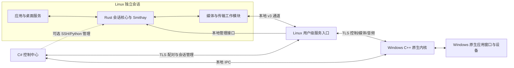

# Waybridge 架构基线

更新日期：2026 年 11 月 14 日。版本：v1 架构基线，含 M0/M1 实现进展。下文区分目标设计、当前实现与待验证优化；Windows 11 x64 首轮真机流程已通过，ARM64 及剩余设备仍待验收，见 [VALIDATION.md](VALIDATION.md)。

Waybridge 提供独立于宿主 DE 的 Linux 远程应用会话，以 Windows 原生独立窗口承载 Blender 等专业软件、日常办公和游戏，网络覆盖同一局域网与异地 VPN。v1 沿用现有 Rust/Smithay、原生编解码层、Windows C++ 内核与 C# 控制中心，围绕会话、窗口、媒体、外设与传输划清职责。

产品功能与建议支持范围见 [FEATURES.md](FEATURES.md)，交付里程碑见 [ROADMAP.md](ROADMAP.md)。办公和游戏共用会话、窗口、输入及协议模型，按窗口选择画面策略。每个会话保留一个 Linux 主进程，在进程内分清模块、线程与资源归属，并管理现成桌面服务子进程；独立连接通过 Linux 用户级服务入口提供。

功能中的设备数量、分辨率、帧率和延迟数值仍按 [推荐支持规格](FEATURES.md#推荐支持规格) 建立实测基线后校准。直接编码、局部更新和 surface 分层保留为优化实验，不作为应用接入或功能模块的前提。

会话与数据策略以 [SESSION_POLICY.md](SESSION_POLICY.md) 为准：默认共享用户数据，创建时单向检查，同一用户本地与远程桌面轮流使用。

配置与桌面集成采用 [CONFIGURATION_POLICY.md](CONFIGURATION_POLICY.md) 的边界：核心提供通用会话机制，外部组件通过标准配置接入；提供用户显式的 Waybridge 专用 desktop 追加/覆写，不内置按应用名称猜测参数的兼容引擎。首版 TOML、GIO 覆写启动与独立 systemd session target 已实现，操作见 [配置](CONFIGURATION.md) 与 [桌面组件](INTEGRATION.md)。

## v1 架构决策

| 决策 | v1 基线 |
|---|---|
| 产品形态 | 独立远程应用会话；应用在会话中启动，每会话一个活动查看端 |
| 宿主关系 | 不要求运行 KWin 或其他 DE；使用现成组件及标准接口，Waybridge 管理会话环境与必要服务 |
| Linux 实现 | 沿用 Rust/Smithay；编解码继续通过现有原生适配层，首轮以当前 NVIDIA 主机为基线 |
| Windows 实现 | C# / WinUI 3 管理连接与设置，独立 C++ 原生内核管理窗口、输入、媒体及本地设备 |
| 进程划分 | 每会话一个 Rust 主进程，媒体、网络和文件 I/O 使用有界工作队列；Xwayland 为会话子进程，钱包及 Portal 使用共享用户服务 |
| 窗口与画面 | 保留每个远端顶层窗口对应 Windows 原生窗口的模式；首轮沿用 Linux 合成窗口内部 surface 树的路径 |
| 办公与游戏 | 共用核心状态和协议；按窗口选择清晰度、帧率、码率、排队和静止后细化策略 |
| 网络 | 产品目标为局域网/VPN 内经过认证和加密的客户端与服务端直连；SSH 是可选的部署、管理与隧道兼容入口，迁移阶段复用现有实现 |
| 外设与数据 | 建立独立的能力适配模块，覆盖键鼠、手柄、触控、笔、双向音视频、剪贴板、文件和打印 |
| 演进方式 | 在现有仓库渐进调整；先移出阻塞 I/O、统一状态和配置契约，再补桌面服务与功能，不以整体重写为前提 |

## 架构总览

图中方框表示职责，不都对应独立进程。窗口消息、媒体、设备和文件按各自模块与通道处理；视频帧和逐次输入不绕经 C# 控制中心。

## 进程与模块边界

| 模块 | 职责与接口边界 |
|---|---|
| Linux 用户级服务入口 | 脱离 SSH 提供配对、客户端信任、会话列举、创建和接入；授予对应会话的连接权限 |
| Linux 会话管理 | 创建会话身份、环境与运行目录，监督必要服务，启动应用，处理查看端接入、断开与显式结束 |
| 合成器与窗口输入 | 拥有 Wayland/X11 协议对象、应用窗口关系、焦点、IME、菜单、触控和笔状态；生成窗口事件并执行客户端请求 |
| 媒体调度 | 根据窗口状态和预算决定捕获时机、呈现策略及编码配置；维护每条媒体流的代次、序列、时钟与背压 |
| 编解码适配 | 封装 GPU 导入、颜色和 alpha 处理及编码；Windows 对应模块封装解码和呈现，显式管理 buffer 与 GPU 同步生命周期 |
| 桌面集成 | 发布正确的会话环境与生命周期，通过标准 unit、D-Bus 和 Portal 接入用户选择的组件；实现需要合成器配合的接口，组件选择和应用偏好留在显式配置 |
| 外设与数据适配 | 把协议能力转换成两端应用可用的输入、音视频设备、剪贴板格式、文件任务和打印任务 |
| 传输 | 认证、连接和通道绑定，消息封装、排队、流量预算与重传；不决定应用焦点或画面内容策略 |
| Windows 原生内核 | 拥有 HWND、DPI 和显示器信息、原生设备句柄、Win32 交互及媒体呈现；执行本地操作并报告能力与实际结果 |
| C# 控制中心 | 配置、配对与连接生命周期、应用目录与启动请求、设备和共享设置、任务进度及诊断；提供可选 SSH 管理入口 |

当前使用独立的 `waybridge-service` Rust 进程，提供 TLS 入口与用户级管理 socket，可选安装 systemd 用户单元。入口重启关闭网络连接但保留存活的会话；每会话的应用及运行期状态仍归相应会话主进程。直连入口与可选 SSH 入口复用同一 Python 会话管理助手，服务固定使用部署时指定的合成器。应用和服务记录所属会话，结束时通过受管进程及可用的进程组或 cgroup 清理，不按进程名影响宿主服务。

合成器与 Windows UI 线程处理必要的平台调用；编码、网络等待、落盘和大块格式转换放到工作线程。GPU 对象遵守各自上下文的线程与同步要求，跨线程任务携带明确的 buffer 所有权或引用及同步信息。模块先沿现有语言边界实现，不要求每个模块拆成 crate 或动态插件。

同进程工作线程可以隔离排队和可处理的错误，不能隔离原生崩溃。若实测编解码崩溃或重启需求要求独立进程，再从已明确的媒体接口拆出；合成器崩溃后的应用恢复不作为 v1 保证。

## 状态与生命周期

| 状态 | 权威归属 |
|---|---|
| 会话、应用和服务 | Linux 会话管理；查看连接具有独立生命周期 |
| 应用窗口关系、约束及焦点 | Linux 合成器；Windows 发请求，接收生效状态与确认 |
| 本地窗口位置、显示器和物理设备 | Windows 内核；DPI、尺寸和设备能力变化通知远端 |
| 期望配置 | 用户配置；由服务端依据两端能力统一解析实际策略，并将结果反馈给 GUI |
| 媒体引用链、缓存和呈现 | 编码与解码端各自维护，按流身份、代次和序列协作 |
| 文件、打印和设备任务 | 具有独立任务身份与状态，所属模块负责取消、清理及恢复 |

区分会话身份、查看连接代次、窗口身份与映射代次、媒体流身份与编码代次。旧连接的输入、旧窗口消息或旧媒体帧不得作用于新目标；新字段通过能力协商引入。

会话按创建、服务就绪、可接入、结束的流程管理，必要服务失败时给出明确错误，可选服务失败时报告相应能力不可用。接入顺序为认证、能力协商、完整窗口与状态快照、增量更新，再启用输入与共享。快照与增量具有明确的顺序边界，避免重连时重复或漏掉窗口变化。

查看端断开时停止输入与设备传输，释放键鼠、触点、笔接触和手柄状态，保留正常运行的 Linux 应用与会话服务。重连接回同一会话；显式结束会话才关闭所属应用与服务。持久钱包、用户工程和已提交文件保留，临时资源按任务状态清理。Linux 主机或合成器重启后需要新建会话，不承诺恢复原 Wayland/X11 连接。

## 画面与资源策略

首轮保留已有路径：Linux 合成窗口内部 surface 树，编码后由 Windows 解码，映射为独立原生窗口；弹出窗口保留自己的关系与画面。显示策略按窗口选择，窗口身份、输入和恢复语义保持统一。

| 预设 | 策略目标 |
|---|---|
| 清晰 | 静态文字、细线与颜色优先；使用无损路径或高保真更新，静止后可细化，减少未变化区域的工作 |
| 专业软件交互 | 兼顾 Blender 等软件的界面清晰度与持续更新的视图；交互时保证响应，停止后恢复精细显示 |
| 游戏低延迟 | 优先控制帧龄和排队，高效视频编码，按带宽与设备能力调整分辨率、帧率及码率 |

预设由同一策略模块解析，不直接等同于固定 codec。首轮保留 H.264 动态画面与 PNG 无损/兼容路径，HEVC/AV1 按已验证的能力启用。自动静止细化、局部更新等是待实现的策略能力；在支持前不把 4:2:0 视频路径宣称为无损办公画质。HDR 与更广颜色工作流继续单列能力验收。

捕获前检查下游额度，保留 dirty 状态，容量恢复时捕获最新内容；等待期间继续处理协议与必要回调。设置全局和每窗口的内存、GPU 资源、带宽及排队预算，并按前台交互、持续画面和后台状态调度。第一阶段保留现有有界编码缓存及呈现确认机制，依据实测调整具体预算。

原始画面和独立图像可以合并到最新状态；已编码的引用帧按流顺序处理，需要丢弃引用链时通过新代次与独立关键帧恢复。局部图块缓存和 surface 分层须定义自己的基准与同步规则，通过实验后再接入，见 [画面研究](#画面路径的研究方向)。

## 通道与协议

继续演进现有协议。控制消息采用可校验的结构化定义，媒体与大块数据使用二进制载荷；Rust、C++、C# 共享字段约定、范围、版本和测试样例，避免同一设置在启动与实时更新时有不同含义。

| 逻辑通道 | 交付与调度语义 |
|---|---|
| 会话与窗口控制 | 可靠交付，生命周期和请求确认保留因果顺序；快照与任务消息限制单次处理量 |
| 输入 | 高优先级；按下、释放、焦点、IME 和手势边界保持顺序。绝对位置可在边界内合并，相对位移累计，按钮事件前保留对应坐标关系 |
| 视频与摄像头 | 按流维护引用链、时序和预算，避免一个窗口缺帧阻塞所有其他窗口 |
| 声音与麦克风 | 独立时钟、序列与有界缓冲，处理设备恢复；会议与视频播放定义音画同步策略 |
| 文件与大载荷 | 可靠分块、进度、取消、续传和配额，单独调度；控制通道只传任务与格式等元数据及有界小载荷 |

目标路径由 Windows 客户端直接连接 Linux 服务在局域网或 VPN 地址上的端口。用户级入口提供初次配对、服务端身份验证、已信任客户端授权和撤销；运行通道绑定已认证的会话与查看连接，日常连接、应用启动与结束会话无需 SSH。首轮以明确配置的地址为入口，自动发现和公网中继另列扩展。

M1 选用标准 TLS：Linux 使用 rustls TLS 1.2/1.3，Windows C# 使用 SslStream，C++ 使用 Schannel TLS 1.2。客户端先校验固定的服务端证书 SHA-256，再发送一次性配对码或客户端凭据；持久客户端令牌存 Windows 凭据管理器，服务端仅存 HMAC 校验值。每条控制、媒体和音频连接分别认证，撤销立即关闭该客户端的活动隧道。业务 v3 封装保持不变；具体握手与限制见 [服务协议](SERVICE.md)。QUIC、实时数据报与按流隔离作为 M2 测量项目。

迁移阶段复用现有 SSH 认证、启动及 TCP 隧道，保留为可选管理与兼容路径。先将文件字节从控制连接分离，保留媒体各自的逻辑通道，逐步改善按流调度、音频格式及共同带宽预算；实际底层路径通过能力协商选择。

经过同一 SSH 连接的多个 TCP 通道仍共享外层 TCP，分离应用队列不能消除所有网络阻塞；VPN 验收同时覆盖 UDP 及 TCP 回退。独立连接也共享总带宽，统一限制文件吞吐和媒体排队。

所有附属通道认证并绑定当前查看连接，能力、密钥与回退结果明确反馈。当前 TLS 网关先验证客户端信任与目标会话，再转发本地 v3；v3 token 与 media_key 继续约束查看连接与附属通道。原始 TCP 必须经 TLS 或 SSH 等受保护传输，现有 UDP 有独立认证加密。兼容扩展使用版本与能力协商，不能兼容的变更提升协议版本，[PROTOCOL.md](PROTOCOL.md) 继续只记录实际实现的线协议。

## 外设与数据能力

七项新增能力及显示、文件等功能按 [功能规格](FEATURES.md#推荐支持规格) 实现，各自具有能力描述、配置、运行状态、停止与恢复流程。UI 显示用户选择、设备实际支持范围和生效结果；数据处理留在原生适配及工作模块。

触控和笔输入优先进入本会话的 Wayland 输入模型，再处理 Xwayland 兼容。手柄通过 Linux 应用可识别的设备接口适配，并单列虚拟设备跨会话可见性和所需权限；同 UID 会话不提供设备沙箱。需要额外权限时使用范围明确的辅助组件，不默认让整个会话以 root 运行。

麦克风与摄像头在 Linux 提供目标应用能识别的源，普通应用与 Flatpak 的设备和 Portal 授权分别处理。剪贴板以多格式数据提供和选择为核心，大载荷沿任务通道传输。打印将远端文档任务交给选定的 Windows 打印队列，按任务标识处理取消和状态查询，重连不自动重复提交。

文件操作明确 Linux 路径、Windows 路径与临时文件的区别。收到文件先写任务临时区，完成校验后提交，已提交文件的生命周期不依赖当前查看连接。数据格式转换、落盘与打印等待不阻塞窗口或输入处理。

## 已确认的需求

- 大型专业软件以 Blender 为核心目标；本机安装的其他应用与游戏见 [功能范围](FEATURES.md#本机应用与游戏清单)，具体首批验收组合待确定。
- 应用在 Waybridge 私有会话中启动，这是当前选定的应用入口。
- 输入除键鼠外，需要手柄、触控和触控笔；音视频需要麦克风语音和摄像头；数据交换需要富文本复制粘贴与打印。具体设备、子集和交付批次待确定。
- 支持同一局域网和异地 VPN。网络策略需要依据实际带宽、往返时间、抖动与丢包情况调整。
- 记录并评估直接编码、局部更新和按需分层传输三条画面优化路径；具体采用哪些路径，由应用行为和测量结果决定。

## 会话独立性原则

Waybridge 定义为可独立启动的远程应用会话环境。部署不要求运行 KWin、Plasma、GNOME Shell 或其他宿主桌面；Waybridge 负责组织本会话的合成器、应用环境和必要服务，优先复用标准接口及现成组件。

| 范围 | 职责边界 |
|---|---|
| 合成、窗口与输入 | Waybridge 的 Smithay 合成器负责，不经宿主窗口管理器转接 |
| 会话管理 | Waybridge 管理环境、用户服务激活与状态、应用启动及结束会话时的资源清理 |
| 密钥、文件选择与常用交互 | 在本会话启动可独立运行的现成实现，原生对话框沿用远程窗口路径；通过接口检查能力，不要求宿主 DE 已经启动服务 |
| 音频与其他用户服务 | 明确本会话拥有的节点和配置；允许使用能脱离 DE 运行的用户服务，是否独立启动服务进程按隔离需求确定 |
| Portal、通知与窗口共享 | 使用标准应用接口，选择适合本会话的后端；需要合成器配合的部分对接 Waybridge |
| 系统能力 | GPU 驱动、文件系统、网络、系统 D-Bus、logind 与 polkit 等按实际需要使用；桌面独立性不要求复制这些系统设施 |

KWallet、Qt、GTK 或 KDE Frameworks 可以成为组件依赖，是否采用取决于它们能否在目标会话独立运行。应用要求的 KDE 专用接口逐项记录兼容范围，不将其等同于必须启动整个 Plasma。用户通过原生 D-Bus、unit 和应用参数选择组件，核心不建立按 provider 名称激活、降级或监控的框架。KWallet 当前版本的接口与后端分工见 [上游说明](https://raw.githubusercontent.com/KDE/kwallet/v6.31.0/README.md)。

本会话使用 Waybridge 桌面身份和标准用户 D-Bus。[会话集成](../src/session_services.rs) 发布显示环境并异步启动独立的 `waybridge-session.target`；结束时先停止声明归属的服务，继续处理其显示请求，再撤销环境。失效旧显示不恢复，后登录桌面的环境不覆盖。D-Bus daemon 无 unset API 的限制明确记录。Portal 选择采用 `integration/` 中可选安装的静态标准配置，不生成运行期替代配置，不强制全局 Qt/GDK 后端。

显示、输入、音频节点和诊断按会话管理；HOME、应用及钱包配置和数据默认共享。断开保留会话，结束时清理会话资源；共享服务遵循用户正常生命周期，不扫描或强杀其他后台进程。旧隔离数据保留，见 [会话策略](SESSION_POLICY.md)。

没有本地图形桌面时验证独立启动。创建前检查 logind 中同一 UID 的活跃或后台 Wayland/X11 用户会话，锁屏仍占用；SSH、TTY、greeter 和其他用户不阻止创建。运行期锁防止多个 Waybridge 同时启动，已有会话重连不重复检查。启动后的 DM 登录交给 DM，不增加 PAM 拦截。本次策略验证与历史设备基线分开记录。

## 当前架构

Linux 侧运行基于 Smithay 的私有无头 Wayland 合成器，并可启动私有 Xwayland。应用在 Linux 绘制内容；合成器管理窗口和输入，将每个窗口的 surface 树绘制到离屏目标，再交给 PNG 或 NVENC 编码。弹出窗口具有独立元数据和画面。

Windows C++ 内核负责 Win32 窗口、D3D11 解码、DirectComposition 呈现、IME、指针锁定、OLE 和音频。Windows 已经在本地将这些远程应用窗口与其他桌面窗口组合起来；当前主要在 Linux 完成单个窗口内部的 surface 合成。

C# 控制中心通过当前用户专用 named pipe 管理原生内核，通过 TLS 管理 API 或兼容 SSH/Python 入口创建或接入 Linux 会话、启动应用。原生内核独立建立 TLS 流，C# 不转发媒体。查看端断线后，正常运行的远端合成器保留应用。合成器崩溃或重启后的应用恢复是另一项能力：应用依赖原 Wayland/X11 连接，进程监督本身不能保证恢复原有应用状态。

TCP 控制、媒体和音频连接分别认证，窗口控制与文件数据目前共用控制连接。可选 UDP 使用认证加密、XOR FEC 和 TCP 补帧，并按全局消息顺序交付媒体。TLS 网关与现有 SSH 隧道均可承载这些 TCP 连接。

实现入口：[TLS 用户入口](../service/src/main.rs)、[合成器](../src/main.rs)、[共享配置](../config/src/lib.rs)、[应用启动助手](../scripts/session-control.py)、[会话环境](../src/launch.rs)、[桌面服务](../src/session_services.rs)、[文件工作队列](../src/transfer_worker.rs)、[网络](../src/network.rs)、[编码调度](../src/video.rs)、[Windows 内核](../client/main.cpp)、[Windows 呈现](../client/presentation.h)、[GUI 会话控制](../gui/Waybridge.Control.Core/SessionController.cs)。当前线协议见 [PROTOCOL.md](PROTOCOL.md)，设备验证范围见 [VALIDATION.md](VALIDATION.md)。

## 画面路径的研究方向

### Surface 与 buffer 的边界

Surface 是应用提交显示内容的对象；buffer 是某次绘制得到的像素内容。一个 surface 可以依次使用多个 buffer。应用的按钮、文字和图片可能已经被工具包合成进同一个 buffer，因此无法根据 surface 自动还原控件或应用内部渲染图层。

Wayland 提供 buffer 交付与显示状态模型，跨机器传输和 Windows 资源适配需要额外协议。把合成移到 Windows，仍然需要传输远端应用渲染出的内容。参考 [Wayland FAQ](https://wayland.freedesktop.org/faq/) 和 [Wayland 渲染模型](https://wayland.freedesktop.org/docs/book/Architecture.html#wayland-rendering)。

### 候选路径

| 路径 | 适用条件与预期收益 | 必须处理的问题 |
|---|---|---|
| 简单窗口直接编码 | 对满足条件的单 surface 窗口，将应用 buffer 导入编码路径，有机会减少离屏合成和复制 | GPU 与格式兼容、裁剪和变换、颜色与 alpha、buffer 生命周期及同步；复杂窗口继续使用现有合成路径 |
| 局部更新 | 对文字、表格和工具界面，只传输发生变化的区域，降低小范围变化的传输成本 | damage 的准确性、缓存基准、更新顺序、缩放和重连后的重新同步；同一 surface 也可使用 |
| 按需分层传输 | 应用确实提供独立更新的多个 surface 时，分别编码，在 Windows 按层级组合 | 多层状态与画面的原子更新、裁剪、变换、透明度、色彩、输入坐标与资源销毁 |

GTK 的常规渲染会将控件渲染结果提交到 surface，graphics offload 则在满足条件时把视频等内容交给 subsurface，说明分层收益取决于实际应用行为。参考 [GTK graphics offload](https://blogs.gnome.org/gtk/2023/11/15/introducing-graphics-offload/)。

现有视频编码已经利用帧间重复内容，分层或局部更新的带宽收益需要与当前路径对照测量。直接编码也不等于全链路零拷贝。三条路径应保留一致的窗口身份、输入和恢复语义，并提供可观测的路径选择与回退原因。

### 首轮测量

选择常用浏览器、办公软件、文件管理器及游戏，记录：

- 每个窗口的 surface 数量、尺寸、更新频率、damage 面积和 buffer 类型。
- 合成、GPU 同步、回读或复制、编码、网络排队、解码及呈现提交的耗时。
- CPU、GPU、显存和传输开销，以及文字、透明度、颜色和输入坐标的正确性。

对比保持相同应用操作、尺寸、DPI、编解码配置和网络条件。先建立现有路径基线，再选择一条路径做最小实验。

## 现有实现的调整重点

以下记录从当前实现迁移到 v1 基线的具体工作。参数与优化算法通过测量选择，不改变上文的模块职责与状态边界。

### 入口与模块拆分

从 `src/main.rs` 与 `client/main.cpp` 中按会话、窗口输入、媒体策略、传输、设备和数据任务提取职责。已有独立模块和平台适配继续复用，入口负责组装与事件分发。拆分以明确状态归属和解除阻塞为目标，每步保留可运行版本及对应集成验收。

Rust、原生编解码、C++ 与 C# 的语言边界保持；新增跨边界接口先定义字段、所有权、错误与取消语义，再接入具体功能。

### 桌面服务与应用联动

应用联动见 [FEATURES.md](FEATURES.md#应用与桌面服务联动)。默认使用用户总线上的原有钱包服务与数据，不做钱包转发，也不创建使用同一钱包文件的私有后端。同 UID 会话不提供文件系统安全沙箱。

建议优先复用 Linux 现成服务及其原生交互界面，让它们与应用运行于同一 Waybridge 显示和总线环境。普通对话框通过现有远程窗口路径显示；通知、窗口共享及明确选择在 Windows 打开的链接、文件与设备请求再按需适配，不预先为所有服务重写 Windows 界面。

历史双私有总线、两套钱包测试仅验证旧方案。当前共享策略使用临时用户数据上的真实 KWallet/GTK Portal 验证，不能据此宣称任意旧钱包迁移或所有应用工作流已经通过。

Portal 前端、后端及服务激活环境必须一致。共享用户总线时同步 D-Bus 与 systemd 用户服务环境。应用单实例与数据锁遵循原有机制，不绕过锁，不为通用残留后台进程增加扫描清理。

polkit 认证代理与真实登录会话或进程的关联、屏幕共享的 PipeWire 输出、Flatpak 文档访问授权分别设计，不将它们等同于普通 D-Bus 名称转发。具体进程部署在完成目标应用的最小验证后确定。

### 会话恢复与输入一致性

会话、查看连接、窗口映射和媒体编码分别维护身份或代次，避免旧连接中的按键、IME 提交、拖放结果或画面影响新目标。完整窗口快照与后续增量更新需要定义一致的恢复边界。

焦点、IME、popup grab、原生 OLE 和指针锁定应由统一的输入状态模型协调。键盘及鼠标按下、释放和焦点切换需要保留因果顺序；绝对鼠标位置可以在明确边界内保留最新值，相对鼠标位移则需要累计，不能按绝对坐标的方式覆盖。

首个恢复目标可限定为查看端或网络中断后的重新接入。服务端崩溃后的工作环境恢复，需要另行确定应用重启、用户数据与恢复能力的范围。

### 全局预算与背压

当前已有每窗口两帧呈现 credit、128 MiB 原始帧队列、空闲编码器缓存及 UDP 传输预算。下一步可将活动编码器、合成目标、解码纹理、带宽与排队时间纳入全局预算，并同时保留每窗口上限。

背压应影响捕获决策。当前合成器在窗口 dirty 时捕获，编码线程之后才检查呈现 credit；下游忙时，可能持续生成随后被替换的画面。可在捕获前检查容量，保留 dirty 状态，并在额度恢复后捕获最新内容，同时继续处理 Wayland 协议和 frame callback。

前台游戏、正在交互的办公窗口和后台窗口可使用不同调度权重。排队预算需要同时考虑字节数、资源数和帧龄，防止平均吞吐正常但交互延迟持续增长。

依赖前帧的视频访问单元在同一 epoch 内保持有序；丢弃引用链需要通过新 epoch 和独立关键帧恢复。增量图块也需要缓存基准及重新同步机制。只有能够独立替换的更新才适合保留最新值。

### 控制与媒体传输

按数据语义划分调度，而不是按单个 socket 的先进先出处理所有工作：

- 窗口生命周期、输入边沿、IME、配置和文件提交使用可靠且具有因果顺序的消息。
- 文件字节使用有界批量传输；其吞吐不应占用输入和窗口控制的响应预算。
- 视频按窗口或媒体流维护顺序，评估去掉当前全局有序交付造成的跨窗口阻塞。
- 音频具有独立时钟和有界播放队列；视频播放与游戏场景可以有不同的同步策略。

局域网和 VPN 共享应用协议，具体数据路径根据能力与测量协商。M1 已以 TLS 独立连接承载日常操作，提供用户服务入口、配对信任与各通道认证；SSH 作为可选管理与隧道兼容路径。通道拆分后的共同拥塞和总带宽预算也必须处理。

### 配置与能力协商

区分用户期望配置、两端协商能力和实际运行路径，并由统一的策略解析生成有效配置。每次设置更新返回接受结果、实际选择及回退原因，连接初始化和实时修改沿用相同语义。

M0 已统一启动与实时设置的 codec 解析：auto + SDR 选择 H.264，auto + HDR 偏好选择 HEVC；实际 HDR 仍受客户端 Main10/PQ 和显示器能力约束。`stream_config` 返回期望 codec、实际选择、HDR 偏好及 PNG 硬限制原因。关闭 HDR 同时阻止每窗口色彩策略继续启用 HDR，并触发重新捕获；真实 NVENC 回归覆盖两个方向及新关键帧代次。JSON 消息可先统一类型、范围、版本及测试样例，再决定是否生成绑定。

### 实时线程与故障隔离

M0 已将 Linux 和 Windows 文件接收移至有界顺序工作队列，完成事件携带连接/选择代次，断线或关闭共享会作废迟到结果；Windows socket 发送由独立有界 FIFO 执行。队列耗尽显式失败并关闭相应连接，避免 UI 等待或无声丢失可靠消息。Linux 故意阻塞落盘及 Windows 慢 I/O/取消风暴回归已覆盖响应性。旧客户端非 file_tree 上传的少量元数据预检仍有同步路径；媒体 GPU 同步和大入口拆分继续渐进改善。

编解码器或单个媒体流失败时，尽量缩小回退范围，并保证输入能够释放、窗口状态能够同步。客户端进程退出与远端会话结束使用明确的不同操作。

### 质量指标与验收

现有指标主要统计同一时钟下的阶段平均值和最大值。建议增加分位数、每窗口队列深度、帧龄、丢弃原因、回退次数和资源占用，以解释高延迟及资源增长。

呈现提交时长、控制 RTT 和各端阶段时间不能直接相加作为物理输入到显示延迟。物理延迟需要单独的端到端实验。

验收矩阵同时覆盖办公与游戏、局域网与 VPN、多窗口并发、文件传输、连续缩放及断线恢复。具体分辨率、刷新率、网络参数和资源上限由目标设备及使用预期确定。

## 实施顺序

| 阶段 | 主要工作 | 完成依据 |
|---|---|---|
| 核心收敛 | 按职责拆入口，移出文件及输入发送的阻塞等待；统一身份代次、配置解析与能力结果，修复 auto/HDR 冲突 | 文件传输、缩放和重连期间仍能操作；启动与实时设置一致；GUI 最新修正在 Windows/WoA 完成实机确认 |
| 独立会话与连接 | 用户级服务入口、配对及认证加密直连、本会话服务管理、原生钱包、Portal 与激活环境、应用启动和单实例处理 | 无宿主 DE、客户端无 OpenSSH 时完成连接及选定应用流程；与宿主桌面并行运行不接管或改写其环境 |
| 媒体与网络 | 捕获前背压、全局预算、逐窗口策略、文件独立通道、按流交付与网络适配 | LAN/VPN 固定场景下测量帧龄、输入响应、清晰度和资源；多窗口及大传输不产生无界积压 |
| 功能交付 | 按功能文档三批接入富文本、麦克风、手柄、触控、笔、摄像头、窗口共享和打印等能力 | 每项达到选定支持范围，实际应用与外设通过；对应的任务、取消和恢复流程可用 |
| 定向优化 | 依据测量选择直接编码、局部更新或 surface 分层中的最小实验 | 性能改善与输入、透明度、颜色及恢复正确性同时成立，保留兼容路径 |

每阶段保持可运行版本，新增功能沿相应模块接入；功能交付可在稳定接口上并行推进，不必等所有画面实验完成。交付顺序与阶段完成条件以 [ROADMAP.md](ROADMAP.md) 为准，功能支持子集见 [功能计划](FEATURES.md#建议的交付批次)。本文件不设未经实现评估的工期。

## 验收与待校准项

架构验收覆盖无宿主 DE 启动、与宿主桌面共存、Windows x64/ARM64、多窗口与混合 DPI、LAN/VPN、网络和设备中断、大文件并发及长时间运行。优先采用功能文档中的 Blender/GIMP、Minecraft、代表性原生及 Windows 游戏、办公与会议应用组合，记录实际运行器及设备能力。

性能数字先作为测量目标，按本地应用基线、远程链路增量及物理输入到画面变化分别报告。待校准的是预算、队列长度、编码与丢包恢复算法、具体设备矩阵，以及直接编码或局部更新等优化路径；会话归属、模块职责、Windows 原生窗口及 DE 独立性作为 v1 基线保持一致。

合成器崩溃恢复、主机重启后恢复应用、多人同时控制及 Windows 之外的查看端另行扩展。新增范围或需要更改基线时，更新本文件的决策及影响，再调整实现和验收。
