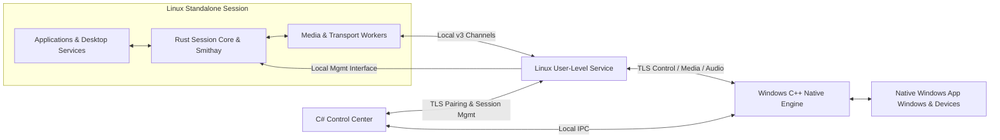

# Waybridge Architecture Baseline

Updated: 2026-11-16. Version: v1 architecture baseline, incorporating M0/M1 lifecycle fixes and the first M2 pass for read-only file delivery, desktop entry points, icons, and plain-text drag-and-drop. This document distinguishes target design, current implementation, and pending optimizations; initial Windows 11 x64 end-to-end runs, HMCL/Minecraft pointer retests, and bidirectional Chrome text drag-and-drop have passed. Full physical ARM64 interaction and the remaining app/device matrices remain open.

Waybridge provides a Linux remote application session independent of any host desktop environment, presenting professional software such as Blender, everyday productivity apps, and games as independent native Windows windows over LAN or VPN. v1 builds on Rust/Smithay, a native codec layer, a Windows C++ engine, and a C# Control Center with clear boundaries across sessions, windows, media, peripherals, and transport.

See [FEATURES.md](FEATURES.md) for product scope and recommended baselines and [ROADMAP.md](ROADMAP.md) for delivery milestones. Productivity and gaming share one session, window, input, and protocol model with per-window visual policies. Each session runs one primary Linux process with bounded internal modules, threads, and resource ownership plus managed desktop service subprocesses; standalone remote connectivity is provided by a Linux user-level service.

Device counts, resolutions, frame rates, and latency targets are calibrated against empirical baselines per [Recommended Support Baseline](FEATURES.md#recommended-support-baseline). Direct encoding, partial updates, and surface layering remain measurement-driven experiments rather than prerequisites for application onboarding.

Session and data semantics follow [SESSION_POLICY.md](SESSION_POLICY.md): shared user data by default, one-way creation checks, and alternating use between local and remote desktops for the same user.

Configuration and desktop integration follow [CONFIGURATION_POLICY.md](CONFIGURATION_POLICY.md): core provides generic session mechanisms, external components integrate via standard configs, and explicit Waybridge-specific desktop overrides replace any hardcoded per-app guessing engine. Initial TOML configuration, GIO override launches, and standalone systemd session targets are implemented; see [Configuration](CONFIGURATION.md) and [Desktop Components](INTEGRATION.md).

## v1 Architectural Decisions

| Decision | v1 Baseline |
|---|---|
| Product form | Standalone remote application session; apps launch inside the session with one active viewer per session |
| Host relationship | Does not require KWin or any host DE; reuses standard interfaces and existing components while Waybridge manages the session environment and required services |
| Linux stack | Rust/Smithay compositor with native codec/GPU interop layer, baselined initially on NVIDIA Linux hosts |
| Windows stack | C# / WinUI 3 for connection management and settings; standalone C++ native engine for windows, input, media, and local devices |
| Process boundaries | One Rust process per session with bounded worker queues for media, network, and file I/O; Xwayland as a session child process; wallets and Portals via shared user services; notification provider as an explicit opt-in session service |
| Windows & visuals | One native Windows window per remote toplevel; initial pass composites each window's internal surface tree on Linux |
| Productivity & gaming | Unified core state and wire protocol; per-window clarity, FPS, bitrate, queuing, and idle-refinement policies |
| Networking | Windows Control Center connects via Waybridge TLS to the Linux user service; system SSH supports deployment, administration, and optional TLS port forwarding |
| Peripherals & data | Dedicated capability adapters for keyboard/mouse, gamepads, touch, pen, bidirectional audio/video, clipboard, files, and printing |
| Evolution strategy | Incremental evolution within the current repository—move blocking I/O off interactive threads and unify state/config contracts first, without a ground-up rewrite |

## Architecture Overview

Boxes represent logical responsibilities rather than strict process boundaries. Window messages, media, peripherals, and files flow through their own modules and channels; video frames and per-event input never detour through the C# Control Center.

## Process and Module Boundaries

| Module | Responsibilities & Interface Boundary |
|---|---|
| Linux user-level service | SSH-free pairing, client trust management, session listing/creation/reattach, and per-session connection authorization |
| Linux session manager | Creates session identity, environment, and runtime dirs; supervises required services; launches apps; handles viewer attach/detach and explicit teardown |
| Compositor & window/input | Owns Wayland/X11 protocol objects, window hierarchy, focus, IME, popups, touch, and pen state; emits window events and applies client requests |
| Media scheduler | Decides capture timing, presentation policy, and codec configuration from window state and budgets; tracks per-stream epochs, sequences, clocks, and backpressure |
| Codec adapter | Encapsulates GPU import, color/alpha handling, and encoding on Linux, and decoding/presentation on Windows with explicit buffer and GPU sync lifetimes |
| Desktop integration | Publishes session environment and lifecycle via standard units, D-Bus, and Portals; implements compositor-coupled interfaces while keeping component selection and app flags in explicit user config |
| Desktop entry adapter | Maps remote app trays, menus, notifications, and actions to Windows; tracks app identity and background status independently of video capture |
| Peripheral & data adapters | Translates protocol capabilities into OS-usable input, audio/video devices, clipboard formats, file tasks, and print jobs |
| Transport | Authentication, connection/channel binding, framing, queuing, bandwidth budgets, and repair; does not decide focus or visual content policy |
| Windows native engine | Owns HWNDs, DPI/monitor state, native device handles, Win32 interactions, and media presentation; executes local actions and reports real capabilities/results |
| C# Control Center | TLS pairing and connection lifecycle, app catalog and launch requests, device and sharing settings, file activity, and diagnostics |

The standalone `waybridge-service` Rust daemon exposes the TLS entry point and a user-private management socket, optionally managed as a systemd user unit. Restarting the entry service closes network connections while keeping live compositor sessions intact. Per-session app and runtime state stays owned by each session's main compositor process. The service invokes the configured compositor through the Python session-control helper; apps and services record session ownership and clean up via managed processes and available process groups or cgroups.

The compositor and Windows UI threads handle required platform calls while encoding, network waits, disk writes, and bulk format conversions run on worker threads. GPU objects respect context thread/synchronization rules, and cross-thread tasks carry explicit buffer ownership/references and sync tokens. Modules follow existing language boundaries without prematurely splitting every module into separate crates or dynamic plugins.

In-process worker threads isolate queuing and recoverable errors, not native crashes. If measured codec crash rates or restart needs demand out-of-process isolation, the media interface is cleanly separable; surviving a compositor crash is not a v1 guarantee.

## State and Lifecycle

| State | Authoritative Owner |
|---|---|
| Sessions, apps, and services | Linux session manager (viewer connections have an independent lifecycle) |
| Window relationships, constraints, and focus | Linux compositor (Windows sends requests and receives effective state/confirmations) |
| Local window geometry, monitors, and physical devices | Windows engine (notifies Linux on DPI, size, and hardware capability changes) |
| Desired configuration | User config; server resolves effective policy against both sides' capabilities and reports back to GUI |
| Media reference chains, caches, and presentation | Maintained jointly by encoder and decoder using stream IDs, epochs, and sequences |
| File, print, and device tasks | Independent task IDs and lifecycles owned by their respective modules for cancel, cleanup, and recovery |

Session IDs, viewer connection epochs, window IDs/mapping generations, and media stream IDs/encode epochs are tracked separately. Input, window messages, or media frames from older generations never mutate newer targets; new fields roll out via capability negotiation.

Sessions progress through create → services ready → attachable → shutdown, failing explicitly when required services fail and reporting degraded capabilities when optional services are unavailable. Viewer attach follows: authentication → capability negotiation → complete window/state snapshot → incremental updates → enable input and sharing, with an explicit ordering boundary between snapshots and deltas so reconnects neither duplicate nor miss transitions.

On viewer disconnect, input and peripheral streams stop, releasing keyboard/mouse, touch contacts, pen contacts, and gamepad state while keeping Linux apps and session services running. Reconnecting attaches to the same session; only explicit session termination shuts down owned apps and services. Persistent wallets, user projects, and committed files remain intact while temporary task state cleans up. After a Linux host or compositor restart, a new session is required; restoring prior Wayland/X11 connections is not guaranteed.

Current implementation enforces these lifecycle invariants (experimental native touch already implements cancellation; pen and gamepads follow the same design):

- Normal exit, app-launch failure, descriptor-publication failure, and returnable event-loop errors all share a teardown path while the display is still active: stop declared bound services first, then revoke the environment and shut down the display. Diagnostic write failures warn without aborting cleanup. Forced termination (`SIGKILL`) or a broken display cannot guarantee components complete display interactions.
- Wayland output globals stop advertising to new clients before delayed reclamation, accommodating in-flight bind requests. Windows OLE callbacks re-verify target window lifetimes after every external call so closing or replacing a window invalidates stale callbacks and queued uploads.
- Xwayland window coordinates stay bounded within the shared root screen, and Windows reports full monitor geometry separately from work-area geometry so maximize, fullscreen, and negative coordinates never desynchronize visual output and absolute input.

## Visual and Resource Policies

The first pass retains the existing pipeline: Linux composites each window's internal surface tree, encodes it, and Windows decodes and presents it into an independent native window (popups preserve their own relationships and surfaces). Visual policy is chosen per window while window identity, input, and recovery semantics remain uniform.

| Preset | Policy Goal |
|---|---|
| Text clarity | Prioritize crisp small text, fine lines, and accurate color via lossless or high-fidelity updates with optional idle refinement and minimal work on unchanged areas |
| Interactive workstation | Balance UI crispness and continuously updating viewports (e.g., Blender)—stay responsive during interaction and sharpen once motion stops |
| Low-latency gaming | Minimize frame age and queuing using hardware video encoding, adapting resolution, FPS, and bitrate to bandwidth and hardware |

Presets resolve through a single policy module rather than hard-binding to a single codec. The initial pass uses H.264 for dynamic motion and PNG for lossless/fallback paths, enabling HEVC/AV1 where verified. Automatic idle refinement and partial updates are planned policy capabilities; until shipped, 4:2:0 video is never misrepresented as lossless office text quality. HDR and wide-gamut workflows remain tracked under separate capability verification.

Capture checks downstream credits beforehand, retains dirty flags, and captures the latest state once capacity opens while continuing to service protocol events and frame callbacks. Global and per-window budgets cover memory, GPU resources, bandwidth, and queuing, scheduled by foreground interactivity, continuous animation, and background status. Phase one retains bounded encoder caches and presentation ACKs, tuning concrete limits from measurements.

Raw frames and standalone images coalesce to the latest state; inter-frame encoded access units remain strictly ordered per stream, recovering from dropped reference chains via a fresh epoch and IDR keyframe. Partial tile caches and surface layering must define their own reference/resync rules and pass isolated experiments before adoption; see [Display Pipeline Research Directions](#display-pipeline-research-directions).

## Channels and Protocol

The existing protocol evolves incrementally: control messages use validated structured schemas while media and bulk transfers carry binary payloads. Rust, C++, and C# share field names, ranges, versions, and test fixtures so startup and live updates always agree.

| Logical Channel | Delivery & Scheduling Semantics |
|---|---|
| Session & window control | Reliable delivery preserving causal ordering for lifecycle and acknowledgements; bounded per-batch work for snapshots and tasks |
| Input | High priority; preserves ordering across press/release edges, focus, IME, and gesture boundaries. Absolute motion coalesces within boundaries, relative deltas accumulate, and button events preserve preceding coordinates |
| Video & webcam | Per-stream reference chains, timing, and budgets so one stalled window never blocks all others |
| Audio & microphone | Independent clocks, sequences, and bounded buffers with device recovery; distinct sync policies for playback vs. conferencing |
| Files & bulk payloads | Reliable chunking, progress, cancellation, resume, and quotas scheduled independently; control channel carries only task/format metadata and small bounded payloads |

The target topology connects Windows clients directly to the Linux service over LAN or VPN. The user-level service handles initial pairing, server authentication, client trust, and revocation; runtime channels bind to authenticated sessions and active viewer connections so daily use requires no SSH. Explicit host configuration comes first, with auto-discovery and public relays deferred.

M1 adopts standard TLS: `rustls` TLS 1.2/1.3 on Linux, `SslStream` in C#, and Schannel TLS 1.2 in C++. Clients verify the pinned server certificate SHA-256 before transmitting any one-time pairing code or client token; persistent tokens live in Windows Credential Manager, and Linux stores only HMAC digests. Control, media, and audio connections authenticate independently, and revoking a client terminates its active tunnels immediately. Business-layer v3 framing remains unchanged; see [Service Protocol](SERVICE.md). QUIC, real-time datagrams, and per-stream isolation remain M2 measurement topics.

The Control Center connects uniformly via Waybridge TLS, while system SSH handles Linux administration and optional TLS forwarding on SSH-only networks. The network track advances dedicated file data channels, per-stream scheduling, audio codecs, and shared bandwidth budgets.

VPN acceptance covers both directly reachable UDP and TCP fallback. Over external SSH forwarding, multiple Waybridge TCP channels share the outer TCP connection; even independent connections share total link bandwidth and require unified pacing across file throughput and media queues.

UDP transmit pacing uses authenticated delivery ACKs and repair feedback under the `--udp-mbps` ceiling; delivery time includes receiver scheduling and is distinct from full congestion control or full encoder-load adaptation (see [Network Experience](NETWORK.md)).

All auxiliary channels authenticate and bind to the active viewer connection, reporting negotiated capabilities, keys, and fallbacks explicitly. The TLS gateway validates client trust and target session before forwarding local v3; v3 tokens and `media_key` continue guarding viewer and auxiliary channels. Raw TCP must always ride over TLS, SSH, or an equivalent protected transport; optional UDP carries its own authenticated encryption. Compatible extensions use version and capability negotiation, breaking changes bump protocol versions, and [PROTOCOL.md](PROTOCOL.md) documents only the wire protocol actually implemented.

## Peripheral and Data Capabilities

The seven new capabilities alongside display and file workflows follow [Recommended Support Baseline](FEATURES.md#recommended-support-baseline), each with capability descriptors, settings, runtime status, stop, and recovery flows. The UI shows user intent, actual hardware capabilities, and effective state while data processing stays in native adapters and worker threads.

Touch and pen target the session's native Wayland input model first, then Xwayland compatibility. Gamepads expose Linux-standard virtual devices while explicitly documenting cross-session visibility and permissions (same-UID sessions are not device sandboxes). Any elevated permission stays isolated in a tightly scoped helper—never running the whole session as root.

Microphones and webcams expose standard Linux sources with separate handling for native apps vs. Flatpak device/Portal grants. Clipboard centers on multi-format offer/selection with large payloads offloaded to task channels. Printing routes Linux jobs to chosen Windows print queues with job-ID cancellation and status polling, never auto-reprinting on reconnect.

File handling keeps Linux paths, Windows paths, and temporary staging distinct. Inbound files write to task staging areas, validate, and commit atomically; committed file lifetimes do not depend on the active viewer connection. Format conversions, disk writes, and print waits never block window or input loops.

Cross-machine file delivery enforces uniform read-only input semantics: apps can read and import delivered files without overwriting them in place or replacing them via rename. Users copy delivered items into a chosen directory through Dolphin or Explorer to obtain independent writable copies managed normally by the destination OS without automatic write-back. Linux publishes completed caches via a session-owned read-only FUSE view returning normal writable permission bits so file-manager copies inherit normal destination permissions; Windows materialized caches use DACLs denying write, delete, and parent-directory replacement without setting the propagating `READONLY` attribute. If read-only protection cannot be enforced, publication is rejected and staged caches are cleaned up. This is not a same-UID/admin security sandbox; completed caches live for the session lifetime rather than disappearing on viewer disconnect. See [Read-Only Delivery](FEATURES.md#read-only-delivery-of-cross-machine-files).

The file adapter owns read-only export, metadata, caching, and lifecycle without inspecting whether a target app is an editor, forcing Save As dialogs, or rewriting unnamed documents. On-demand network FUSE reads are a future optimization; the current FUSE view exposes fully received local bytes. Standard drag-and-drop, clipboard, and native file dialogs remain the interaction model without building a custom cross-machine file picker or bidirectional sync framework.

Drag-and-drop separates immutable data representation, session negotiation/finalization, native protocol adapters, input, and visuals. Cross-machine text drag-and-drop is independent of file and clipboard switches; delivery state survives drop until target `Finish`. Source generations, target revisions, and COM callback leases prevent late reads, stale acceptances, and reentrancy from corrupting newer targets. Bounded STA message-pumped waits bridge synchronous OLE callbacks and asynchronous Wayland negotiation; see [Drag-and-Drop Design](DRAG_AND_DROP.md) for limits (no arbitrary-latency delivery guarantees or app-level rollbacks).

## Confirmed Requirements

- Blender is the core professional workstation target; other installed apps and games are cataloged in [FEATURES.md](FEATURES.md#installed-applications-and-games-snapshot), with initial acceptance subsets refined incrementally.
- Applications launch inside a private Waybridge session.
- Input covers keyboard, mouse, gamepads, multitouch, and stylus pen; A/V covers playback, microphone, and webcam; data exchange covers rich-text clipboard and printing.
- Networking covers both LAN and remote VPN, adapting to real bandwidth, RTT, jitter, and packet loss.
- Direct encoding, partial updates, and selective layered transfer are evaluated empirically rather than assumed upfront.

## Session Independence Principles

Waybridge is a standalone remote application session that does not require KWin, Plasma, GNOME Shell, or any other host desktop environment. Waybridge organizes its own compositor, app environment, and required services while reusing standard interfaces and existing components.

| Scope | Boundary |
|---|---|
| Compositing, windows & input | Owned by Waybridge's Smithay compositor without routing through a host window manager |
| Session management | Waybridge manages environment, service activation/status, app launching, and teardown cleanup |
| Secrets, file pickers & dialogs | Runs standalone native implementations inside the session; dialogs render as remote windows without requiring a host DE |
| Audio & user services | Explicitly tracks session-owned nodes and configs; reuses DE-independent user services with isolation where needed |
| Portals, notifications & sharing | Uses standard application interfaces with session-appropriate backends; compositor-coupled backends integrate with Waybridge |
| System facilities | Uses host GPU drivers, filesystem, network, system D-Bus, `logind`, and polkit as normal without duplicating OS infrastructure |

Components such as KWallet, Qt, GTK, or KDE Frameworks may be used whenever they run independently inside the session; KDE-specific interfaces required by apps are tracked per app without implying all of Plasma must run. Users select components via native D-Bus, systemd units, and app flags rather than a core framework that activates or patches providers by name (see [KWallet upstream docs](https://raw.githubusercontent.com/KDE/kwallet/v6.31.0/README.md)).

Sessions publish a Waybridge desktop identity on the standard user D-Bus bus. [Session Services](../src/session_services.rs) exports the display environment and asynchronously activates the standalone `waybridge-session.target`; shutdown stops bound services while continuing to service display requests, then revokes environment variables still owned by the session (never restoring stale displays or overwriting a later desktop login, documenting `dbus-daemon`'s lack of an unset API). Portal selection uses optional static standard configs in `integration/` without runtime config generation or global Qt/GDK overrides.

Display, input, audio nodes, and diagnostics are session-scoped while `HOME`, app configs, wallets, and data are shared by default. Disconnects keep sessions alive; explicit shutdown cleans up session resources while shared services follow normal user lifecycles without sweeping unrelated background processes. Legacy isolated directories remain untouched per [SESSION_POLICY.md](SESSION_POLICY.md).

Standalone startup is verified with no local graphical desktop running. Pre-creation checks query `logind` for active or background Wayland/X11 sessions belonging to the same UID (locked screens still count; SSH, TTYs, greeters, and other users do not block). A runtime lock prevents concurrent Waybridge startups, and reattaching skips creation checks. Subsequent logins through other display managers are left to those DMs with no PAM hooks.

## Current Architecture

Linux runs a private headless Smithay Wayland compositor with optional private rootless Xwayland. Applications render on Linux; the compositor manages windows and input, composites each window's surface tree to an offscreen target, and encodes via PNG or NVENC. Popups maintain independent metadata and surfaces.

The Windows C++ engine handles Win32 windows, D3D11 decoding, DirectComposition presentation, IME, pointer lock, OLE, and audio—letting Windows natively composite remote app windows alongside local windows while Linux composites each window's internal surface tree.

The C# Control Center controls the native engine over a current-user private named pipe and manages Linux sessions and app launches over the TLS management API. The native engine opens its own TLS streams so C# never proxies media. Viewer disconnects leave remote apps running on the live compositor. Recovering app state after a compositor crash or reboot is a separate problem because Wayland/X11 clients depend on live compositor connections.

TCP control, media, and audio connections authenticate independently; window control and file metadata share control while negotiated peers offload file bytes to the dedicated file channel. Optional UDP uses authenticated encryption, XOR FEC, and TCP frame repair with global media ordering. Both the TLS gateway and external SSH tunnels can carry the TCP channels.

Existing M0/M1 verification is the baseline while media scheduling and M2 everyday features progress. Pre-capture backpressure and queue diagnostics are active; per-window clarity/interactive/gaming policies, full media resource budgets, dedicated file channels, and full network/encoder coordination are being rolled out incrementally; experimental native touch, pen, and gamepads/rumble are available opt-in with physical device/app matrices still expanding; webcam, window sharing, and printing remain ahead. Status is tracked authoritatively in [ROADMAP.md](ROADMAP.md#current-progress).

Key entry points: [TLS user service](../service/src/main.rs), [compositor](../src/main.rs), [shared config](../config/src/lib.rs), [session helper](../scripts/session-control.py), [session launch env](../src/launch.rs), [desktop services](../src/session_services.rs), [file worker](../src/transfer_worker.rs), [network](../src/network.rs), [capture](../src/capture.rs), [video scheduling](../src/video.rs), [Windows engine](../client/main.cpp), [Windows presentation](../client/presentation.h), [GUI session controller](../gui/Waybridge.Control.Core/SessionController.cs). See [PROTOCOL.md](PROTOCOL.md) for the implemented wire protocol.

## Display Pipeline Research Directions

### Surface vs. Buffer Boundaries

A Wayland surface receives display state from a client, while a buffer holds one rendered pixel frame. Toolkits frequently composite buttons, text, and images into a single buffer before committing, so Wayland surfaces cannot automatically reconstruct widget trees or arbitrary internal app layers.

Wayland defines buffer delivery and display state, not cross-machine transport or Windows resource mapping. Even if compositing moves to Windows, remotely rendered pixels must still cross the network. References: [Wayland FAQ](https://wayland.freedesktop.org/faq/) and [Wayland Rendering Architecture](https://wayland.freedesktop.org/docs/book/Architecture.html#wayland-rendering).

### Candidate Optimizations

| Path | Conditions & Expected Gain | Required Problems to Solve |
|---|---|---|
| Direct single-surface encoding | Import qualifying single-surface client buffers directly into encoding to reduce offscreen compositing and copies | GPU/format compatibility, crops and transforms, color and alpha, buffer lifetime and sync; complex windows retain compositing |
| Partial updates | Transmit only changed regions for text, spreadsheets, and tool UIs to cut small-change bandwidth | Damage accuracy, cache baselines, ordering, scaling, and reconnect resync (applicable within a single surface too) |
| Selective layered transfer | When an app genuinely submits independently updating subsurfaces, encode separately and composite on Windows | Atomic multi-layer state/frame commits, clipping, transforms, alpha, color, input coordinates, and teardown |

GTK's regular rendering flattens widgets into one surface while graphics offload promotes qualifying video into subsurfaces, illustrating that layering wins depend strongly on real app behavior (see [GTK graphics offload](https://blogs.gnome.org/gtk/2023/11/15/introducing-graphics-offload/)).

Existing video codecs already exploit temporal redundancy, so partial updates or layering must be benchmarked against the baseline, and direct encoding is not automatically end-to-end zero-copy. All three paths must preserve window identity, input, and recovery semantics with observable path selection and fallback reasons.

### Initial Measurements

Benchmark representative browsers, office apps, file managers, and games, recording:

- Per-window surface counts, sizes, update rates, damage areas, and buffer types.
- Stage latencies across compositing, GPU sync, readback/copy, encoding, network queuing, decoding, and presentation submit.
- CPU, GPU, VRAM, and bandwidth cost alongside text crispness, alpha, color, and input coordinate accuracy.

Hold app actions, window dimensions, DPI, codec config, and network conditions constant—baseline the current path first, then run one minimal experiment.

## Current Implementation Focus Areas

Concrete transition steps from the current codebase to the v1 baseline (parameters and algorithms are chosen by measurement without shifting module boundaries):

### Entry Points and Modularization

Extract session, window/input, media policy, transport, device, and data-task modules cleanly out of `src/main.rs` and `client/main.cpp` while keeping runnable builds and passing integration regressions at every step.

Maintain existing Rust, native codec, C++, and C# boundaries; define fields, ownership, error, and cancellation semantics before wiring new cross-boundary features.

### Desktop Services and Application Integration

See [FEATURES.md](FEATURES.md#application-and-desktop-service-integration). Waybridge defaults to the native secret service and data on the user bus without forwarding wallets or spawning duplicate private backends over the same wallet files. Same-UID sessions do not provide a filesystem security sandbox.

Prefer reusing existing Linux services and their native UIs inside the Waybridge display/bus environment so ordinary dialogs stream as normal remote windows. Only notifications, window sharing, and explicit Windows-side link/file/device integrations require native Windows UI adapters.

Historical dual-private-bus wallet tests validated the older isolated design. The shared-data policy has been validated against real KWallet and GTK Portals on temporary user data, and real Chrome login recovery after native wallet unlock has been confirmed—without claiming migration of legacy isolated wallets, every password backend, or all app workflows.

Portal frontends, backends, and service activation environments must stay aligned by syncing D-Bus and systemd user environments. Single-instance locks follow native app rules without bypassing locks or sweeping unrelated background processes.

Polkit authentication agents bound to real login sessions, PipeWire ScreenCast outputs, and Flatpak document-portal grants are designed separately rather than conflated with plain D-Bus name forwarding.

Remote app trays, notifications, and background entries form the first M2 pass: SNI/DBusMenu runs on a bounded Linux worker and maps to native Windows Shell trays and menus; the background list shows SNI-identified entries and invokes app-provided restore/exit actions. XEmbed, richer dynamic menus, and broader app matrices remain tracked separately. See [Desktop Integration Delivery Checklist](FEATURES.md#desktop-integration-delivery-checklist) and [Application Trays](DESKTOP-TRAY.md).

Notifications run through the explicitly opted-in `waybridge --notification-provider` process and optional session user unit hosting standard `org.freedesktop.Notifications`, talking to the compositor over a session-private Unix datagram socket. It never steals an existing daemon or snoops on another daemon's traffic; blocking D-Bus, icon resolution, and leases stay in helper/diagnostic threads while the compositor handles bounded structured events.

The Windows C++ worker validates notification identity, connection binding, revision, sharing, and read-only policy before passing structured payloads over the private named pipe to C# Windows App SDK AppNotifications. C# processes notifications, OS settings, and actions on an independent bounded queue while video and input stay in C++. Forwarding activates only after GUI confirms native notifications are ready, disables cleanly on platform unavailability or overflow, and clears stale actions on disconnect or provider loss. Windows manages Do Not Disturb and Notification Center.

Window icons and taskbar identity are independent: each toplevel receives an `AppUserModelID` keyed by connection profile ID and Linux `app_id` so multi-window apps group together, unknown apps stay separate, and reconnects keep stable identity (direct worker launches use host/port). Properties clear before window destruction; taskbar pinning and relaunch shortcuts are withheld so Windows never pins a generic worker shortcut that cannot restore the remote app (see [SHGetPropertyStoreForWindow](https://learn.microsoft.com/en-us/windows/win32/api/shellapi/nf-shellapi-shgetpropertystoreforwindow)).

The Linux adapter owns standard interface objects, app provenance, and state; the Windows native integration layer owns tray/menu/notification presentation and user actions; the Control Center owns configuration and the background-app list. Both sides exchange structured state/actions rather than video-encoding tray icons, keeping blocking D-Bus I/O out of compositor and UI loops.

Trays prioritize StatusNotifierItem Host/Watcher + DBusMenu, tracking legacy XEmbed separately. Notifications require explicit provider opt-in; existing bus name owners are respected and conflicts are surfaced cleanly. Having no open toplevel window never implies an app exited; exit, hide-to-tray, viewer disconnect, and session shutdown remain distinct.

Items and menus carry stable IDs, source identity, and generations; reconnects send fresh snapshots, invalidating stale clicks and callbacks, and Explorer restarts rebuild icons cleanly. Icons, menu depth, update rates, and notification sizes are bounded; Linux resolves icon paths locally, falling back to remote menu windows when native menus are unavailable. Wire negotiation uses `tray_v1` and `notifications_v1` (see [PROTOCOL.md](PROTOCOL.md)).

Windows composites source badges onto native window and tray icons via `NativeIcon` / `IconBadge` at the target pixel size, refreshing on DPI or badge changes while preserving originals separately. The Control Center fetches raw catalog icons and Windows notifications show scaled originals. Profiles store normalized PNGs, and badging lives strictly on the Windows client. See [Icons and Remote Identity](FEATURES.md#icons-and-remote-identity).

### Session Recovery and Input Consistency

Sessions, viewer connections, window mappings, and media encoders maintain distinct identities/generations so late keys, IME commits, drag results, or frames from old connections never affect new targets. Full window snapshots and subsequent deltas share a clear recovery boundary.

Focus, IME, popup grabs, native OLE, and pointer lock coordinate through one input-state model: key/button press-release edges and focus switches keep strict causal order, absolute pointer motion coalesces within boundaries, and relative deltas accumulate rather than overwrite.

The primary recovery target is viewer or network drop recovery against a live session; recovering apps after a server crash requires a separate workspace-recovery design.

### Global Budgets and Backpressure

In addition to per-window 2-frame presentation credits, the 128 MiB raw frame queue, and UDP transport budgets, Linux capture/encode workspaces, GL targets, CUDA pools, and active/idle encoders are accounted under session and per-window budgets backed by live resource leases (with explicitly labeled estimates for GPU/codec memory; see [Media Budget](MEDIA_BUDGET.md)). Windows decode/present textures, transport payloads, and driver-private resources continue expanding coverage.

Backpressure governs capture directly: `src/capture.rs` checks presentation credits, per-window pending encode slots, and raw queue capacity before compositing and readback, keeping surfaces marked dirty when downstream is busy and capturing fresh pixels once capacity frees while continuing to process Wayland protocol, metadata, and frame callbacks. The raw queue enforces its 128 MiB ceiling against actual CPU/CUDA bytes on enqueue—rejecting without evicting other windows' final updates—and re-enqueued unencoded updates trigger recapture if the cap is hit.

Foreground games, active office windows, and background windows can receive distinct scheduling weights. Queue budgets account for bytes, resource counts, and frame age together so average throughput cannot mask growing interactive latency.

Inter-frame encoded units stay strictly ordered within an epoch; dropping a reference chain recovers via a new epoch and IDR keyframe. Incremental tiles likewise require reference baselines and resync rules; only self-contained updates can coalesce to latest.

### Control and Media Transport

Schedule by data semantics instead of single-socket FIFO:

- Window lifecycle, input edges, IME, config, and file commits use reliable causally ordered messages.
- File bytes use bounded bulk transfer without stealing interactive responsiveness from input or window control.
- Video maintains per-window/per-stream order, evaluating removal of cross-window head-of-line blocking from global media ordering.
- Audio keeps an independent clock and bounded playback queue with distinct sync policies for video playback vs. gaming.

LAN and VPN share the same application protocol while negotiating transport behavior from capabilities and measurements. M1 runs daily traffic over independent TLS connections with user-service pairing/trust and per-channel auth, keeping SSH as an optional admin/tunnel path; split channels still share total link bandwidth and require coordinated congestion budgets.

### Configuration and Capability Negotiation

Distinguish user-desired config, negotiated capabilities, and effective runtime paths through one unified policy resolver. Every setting update returns acceptance, effective choices, and fallback reasons with identical semantics at startup and live update.

M0 unified startup and live codec resolution: `auto` + SDR selects H.264, `auto` + HDR preference selects HEVC, while actual HDR remains gated by client Main10/PQ and display capabilities. `stream_config` reports desired codec, effective choice, HDR preference, and PNG hard-limit reasons. Disabling HDR prevents per-window color policy from staying in HDR and triggers recapture (verified in both directions with real NVENC and new keyframe epochs). JSON schemas align types, bounds, versions, and shared test vectors across languages before considering code generation.

### Real-Time Threads and Fault Isolation

M0 moved Linux and Windows file receiving to bounded sequential worker queues with connection/selection generations so disconnects or disabling sharing invalidate late completions, and moved Windows socket sends to a dedicated bounded FIFO. Queue exhaustion fails explicitly and closes the affected connection rather than blocking the UI or silently dropping reliable messages. Deliberately stalled Linux disk writes and slow Windows I/O / cancellation storms are covered by regressions. Small metadata prechecks on legacy non-`file_tree` uploads remain synchronous; media GPU sync and entry-point modularization continue incrementally.

Codec or single-stream failures fall back with the narrowest possible blast radius while ensuring inputs release and window state stays synced. Exiting the client and terminating the remote session remain distinct operations.

### Quality Metrics and Verification

`--stats` reports local-clock stage averages, maximums, and P50/P95/P99 every two seconds using fixed-size microsecond histograms (reporting bucket upper bounds capped by observed maximums, ≤ 6.25% rounding error). It tracks capture, raw encode queue, capture-to-encode/network queue, media send queue, and latest/peak raw queue counts and bytes. Wait counters separate presentation-credit, encode-slot, and queue-budget stalls (poll counts, not dropped frames). Per-window resources, fallback counters, and physical latency baselines continue expanding.

Presentation submit times, control RTT, and per-endpoint stage durations cannot simply be summed as physical input-to-display latency; physical latency requires dedicated end-to-end measurement.

Verification matrices span productivity and gaming, LAN and VPN, multi-window concurrency, file transfers, continuous resizing, and disconnect recovery, calibrated against target hardware and user expectations.

## Implementation Sequence

| Phase | Core Work | Completion Evidence |
|---|---|---|
| Core consolidation | Split large entry points, remove blocking file/send waits, unify IDs/generations/config resolution, fix `auto`/HDR conflict | UI stays responsive across transfers, resizes, and reconnects; startup and live settings match; latest GUI fixes confirmed on Windows/WoA |
| Standalone sessions & connectivity | User-level service, pairing & encrypted direct transport, session service management, native wallets/Portals/activation env, app launching & single-instance rules | Connect and run selected apps with no host DE and no Windows OpenSSH; run cleanly alongside host desktop policies without hijacking its env |
| Media & network | Pre-capture backpressure, global budgets, per-window policies, dedicated file channel, per-stream delivery, network adaptation | Measured frame age, input responsiveness, clarity, and resource bounds on LAN/VPN; zero unbounded buildup under multi-window + large transfers |
| Feature delivery | Deliver rich text, microphone, gamepads, touch, pen, webcam, window sharing, and printing in three waves per [FEATURES.md](FEATURES.md) | Each meets target baseline on real apps and hardware with working task/cancel/recovery flows |
| Targeted optimization | Run minimal measurement-backed experiments for direct encoding, partial updates, or surface layering | Measured gains hold simultaneously with input, alpha, color, and recovery correctness, preserving compatible fallbacks |

Every phase maintains a runnable build; features plug into stable module interfaces in parallel without waiting on display-pipeline experiments. Delivery order and exit criteria live in [ROADMAP.md](ROADMAP.md), and feature batches live in [FEATURES.md](FEATURES.md#recommended-delivery-batches).

## Verification and Items to Calibrate

Architectural verification covers headless startup without a host DE, same-UID local-desktop admission rejection and alternating use, Windows x64/ARM64, multi-window + mixed DPI, LAN/VPN, network/device interruptions, concurrent large file transfers, and long-running soak tests. Later DM logins after Waybridge startup remain unblocked. Representative combinations prioritize Blender/GIMP, Minecraft, native and Windows games, and productivity/conferencing apps, recording exact runners and device capabilities.

Performance numbers start as measurement targets reported separately as local app baseline, remote-link overhead, and physical input-to-photon response. Parameters to calibrate include budgets, queue depths, encoding and loss-recovery algorithms, device matrices, and display optimizations; session ownership, module boundaries, native Windows windows, and DE independence remain fixed as the v1 baseline.

Compositor crash recovery, post-reboot app recovery, multi-user control, and non-Windows viewers are future extensions. Any scope expansion or baseline change updates this document's decisions and impact analysis before modifying implementation and verification.

### Native Drag-and-Drop and Backend Boundaries (2026-11-17)

Keyboard, pointer, touch, and drag-and-drop share one unified Wayland/X11 focus target while respecting surface input regions. Smithay's `Source` / `DndFocus` / `OfferData` subsystem handles sources, targets, and protocol offers; Waybridge's `TrackedSource` enforces source identity and single finalization; `Coordinator` owns external snapshots, target revisions, and export leases. Protocol callbacks never re-enter input locks; cleanup runs on the main loop, and cleaning up a stale source can never terminate a newer export.

Intra-session Linux drags preserve native selections, MIME types, and COPY/MOVE; cross-machine drags export selected text/file representations as read-only COPY. X11 uses shadow targets on the private root to connect native drags with independent HWNDs, and drag visuals never steal menu input grabs. Waybridge selectively backports a pinned upstream generic DND subsystem and removes the legacy one-way COPY production adapter without adding app-name branches. XWM queries still run on the compositor thread, so isolating blocking X11 round-trips and expanding real-app verification remain open; see [XDND.md](XDND.md) for provenance, actions, timing, and verification.
