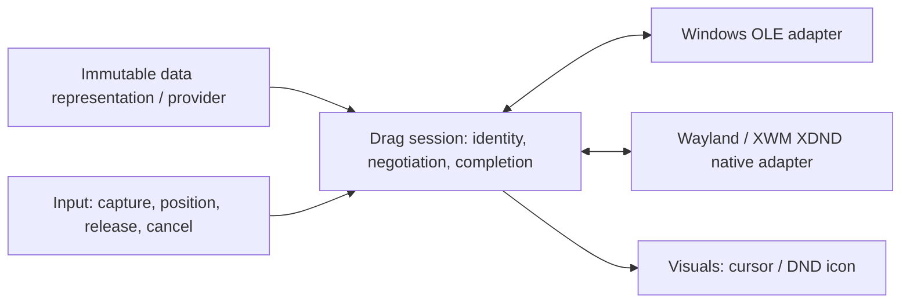

# Drag-and-Drop Data and Lifecycle

Updated: 2026-11-17. This round first fixed a real failure dragging selected text from Windows Chrome into a streamed Chrome input box, while refactoring shared interfaces without adding per-application branches for Chrome, QQ, or others. See [Desktop Interactions](DESKTOP_INTERACTIONS.md) for the direction and format matrix.

## Why Transfers Failed Despite Bytes Arriving

Windows OLE `DragEnter` must synchronously return an accepted drop effect, whereas Linux applications accept MIME types and actions asynchronously over Wayland. The previous implementation treated "acceptance not yet received" as "rejected". When a user dragged text over an input and released immediately, Windows Chrome finished with `NONE`, and the later Linux acceptance could not salvage the gesture. Earlier Qt probes that paused before dropping did not catch this timing window.

Additionally, the pointer keeps moving while waiting. Waiting only for an acceptance at an old position is insufficient: acceptance must match the current target and drop point rather than a widget, window, or offer already left behind. After drop, the client must also wait for the target to finish delivery instead of reporting success to the source as soon as the drop message is sent.

## Responsibilities and Interfaces

- **Data representation**: `src/data_offer.rs` owns immutable MIME snapshots; `client/text_offer.h` reads bounded Unicode text from an OLE provider and normalizes it to UTF-8. Neither decides focus, mouse buttons, or drag success. Files continue using constrained read-only views and lazy `IStream`s without masquerading text as temporary files.
- **Session**: `src/data_drop.rs::Coordinator` manages external target negotiation, snapshots, delivery, and source export leases; Windows `client/drag_session.h` tracks negotiation/completion facts, and `client/text_drag.h` connects native targets to the protocol. `Pending`, `Accepted`, and `Rejected` are distinct, as are `Hover`, `Dropping`, and `Delivering`/`Completed`.
- **Adapters**: OLE, Wayland, and private XDND report protocol acceptance, actions, reads, `Finish`, or cancellation. Protocol actions are never inferred merely from button release. Smithay's generic `Source` / `DndFocus` / `OfferData` bridges both Linux backends, and `TrackedSource` unifies source identity and single finalization; input callbacks record facts while the main loop updates export leases and focus to avoid re-entering input locks.
- **Input and visuals**: Ordinary key/button releases do not clear data currently being delivered. External injection uses an isolated synthetic button marker so it releases only grabs it created; DND icons never own data sources or completion state.

This is an incremental cleanup: existing file exports, async reads, and OLE return-to-session paths keep their own adapters rather than being rewritten into a monolithic all-format engine. Cross-machine drags currently bridge selected text and file representations, while intra-session drags continue using native application MIME negotiation.

## Identity and Invalidation

1. **Gesture ID** identifies a single source drag. Windows OLE may re-wrap `IDataObject` across HWNDs, so `IUnknown` identity cannot reliably detect a new source. Windows tracks mouse press/release generations independently to retain a bounded single-read text snapshot and reuse it across HWNDs; even while the STA is waiting, releasing and pressing again invalidates the old cache. The observer runs only while that external text snapshot is alive, on a dedicated thread that solely increments a counter and passes input straight through without intercepting clicks or recording coordinates or data, following [LowLevelMouseProc thread requirements](https://learn.microsoft.com/en-us/windows/win32/winmsg/lowlevelmouseproc). If the observer cannot be installed, cross-target caching is disabled and each target re-reads instead of guessing press boundaries by polling. Snapshots are released on completion, cancellation, disconnect, policy change, or after at most 120 seconds.
2. **Target revision** increments across target negotiations. Refreshing a drop position or switching targets invalidates old Wayland offers and renegotiates; acceptance and completion messages from older revisions cannot mutate current state. Refreshes reuse the cached text snapshot without resending text bytes.
3. **Native callback lease** distinguishes native target instances across COM reentrancy. `QueryGetData`, `GetData`, `ReleaseStgMedium`, and message pumping can all trigger close, cancel, or re-entry, so leases and window lifetimes are re-checked after every external call.
4. **Source generation** binds Linux-delivered immutable snapshots. Old offers can lazily `Receive` their own data, and their `Finish` retires only their own snapshot without ending a newer drag. At most 16 snapshots are retained for up to 120 seconds, and protocol sources hold only weak references so a client retaining an old offer does not pin retired payloads indefinitely. Pipe writes enforce concurrency and deadline limits.

## Synchronous OLE Boundaries

Against updated servers, text `DragEnter` and final `Drop` wait at most 750 ms for target acceptance while pumping the STA message loop and re-validating the native lease, live window, and drop point. While negotiation is pending, periodic DND motion updates at the current location allow asynchronous toolkits to update acceptance without synthesizing clicks. Final `Drop` forces a fresh target revision.

Once accepted, the client sends `drop` and waits up to 2 seconds for target `Finish`, returning `COPY` to the OLE source only on confirmed success. Pressing Escape, closing the window, read-only mode, disconnecting, or disabling text drag-and-drop cancels the active negotiation. Timeouts return `NONE` without leaving unbounded waits or delayed retries behind.

These are bounded waits, not guarantees over arbitrary network latency. Very slow links may not finish negotiating within 750 ms; if a target inserts text but the completion receipt is lost, the client cannot prove delivery, logs `delivery.unknown`, and stops without retrying automatically. It cannot undo data an application has already accepted, nor does it promise cross-application transactions or exactly-once semantics.

Updated servers advertise `data_drag_result_v1`; updated clients send retargets, match revisions, and wait for completion only when that capability is present. Older servers keep legacy compatibility behavior, so the full fix requires updating both ends. See [Protocol: Generic MIME drag negotiation (`data_drag_v1`)](PROTOCOL.md#generic-mime-drag-negotiation-data_drag_v1).

## Native Touch Integration

Drag-and-drop now preserves the initiating touch slot, gesture, and action ID so text and file drags between native Wayland streamed windows are driven by the originating contact's move, up, and cancel events. Native data sources, MIME types, COPY/MOVE, cross-machine read-only file delivery, and completion receipts are reused. Export, claim/drop/return no longer assume the left mouse button; leaving and returning keeps the same source, and async file reads remain decoupled from physical contact lifetime.

Windows adds a name-resolved system touch-to-mouse handoff that performs bounded negotiation inside the real synthesized-mouse stack before entering OLE. Because the physical test laptop was locked during the probe run, the probe stopped before touch injection, so the full Windows touch → OLE forward path still awaits unlocked-desktop verification; presence of the OS API alone is not treated as drag success. Automatic detection of application `wl_touch` subscriptions is enabled by default, with per-app mouse-compatibility overrides available. See [Touch Interaction](INPUT_DEVICES.md#window-popup-and-drag-integration--2026-11-18) for protocol details, settings, and verification scope.

## Settings, Diagnostics, and Verification

**Sharing & Permissions → Text drag-and-drop** in the Control Center independently controls cross-machine bidirectional text drags (enabled by default, separate from clipboard direction and file sharing). Read-only mode still takes precedence and blocks input. Legacy profiles missing this field default to enabled; intra-session drags between remote Linux applications are unaffected by cross-machine sharing toggles.

Setting `WAYBRIDGE_DND_TRACE=1` logs OLE format names, gesture IDs, revisions, byte counts, and phases without logging text contents (off by default).

Physical Windows x64 + Linux Chrome testing with isolated profiles covered bidirectional dwell and immediate release, Escape, +120 ms per-direction injected protocol delay, reject zones, timeout cancellation, drags between two streamed windows, and a single Windows source moving across targets—verifying both target text and source `COPY`/`NONE`.

Standard Linux/Wine regressions cover stale offers, late Receive/Finish, revision isolation, COM reentrancy, sharing toggles, native file MOVE, read-only files, and drag visuals. X11 source/target and mixed-backend drags now share the same native session path; see [XDND.md](XDND.md) for coordinates, native selection ownership, requested vs. accepted actions, delayed reads, and completion confirmation. Cross-machine HTML/RTF/image drags, X11-specific drag visuals, and pre-transfer file hover remain follow-up work; passing protocol fixtures does not claim compatibility across all real applications.
