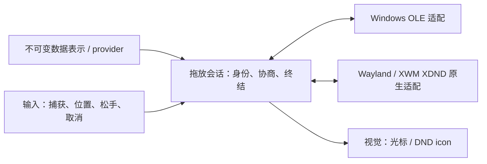

# 拖放的数据与生命周期

更新：2026-11-17。本轮首先修复 Windows Chrome 选中文字拖到串流 Chrome 输入框的真实失败；同时整理通用接口，不按 Chrome、QQ 或其他应用名称分支。方向与格式范围见 [桌面交互矩阵](DESKTOP_INTERACTIONS.md)。

## 为什么原来有字节传输仍然会失败

Windows OLE 的 `DragEnter` 必须同步给出可用动作，而 Linux 应用通过 Wayland 异步接受 MIME 和动作。原实现把“尚未收到接受”当成了“不接受”。用户拖到输入框后立即松手时，Windows Chrome 已按 NONE 结束，稍后到达的 Linux 接受消息无法挽回这次手势。停留后成功的 Qt 探针没有覆盖这个时序。

另外，等待期间鼠标仍在移动。仅等待旧位置的接受也不够：接受的必须是当前目标及落点，不能沿用离开过的控件、窗口或旧 offer 的结果。松手后还需要等待目标结束交付，不能仅发送 drop 就向源报告成功。

## 职责和接口

- **数据表示**：`src/data_offer.rs` 拥有不可变 MIME 快照；`client/text_offer.h` 从 OLE provider 读取有界 Unicode 文本并规范为 UTF-8。它们不决定焦点、按钮或拖放是否成功。文件仍使用受限的只读视图和延迟 IStream，不把文字伪装成临时文件。
- **会话**：`src/data_drop.rs::Coordinator` 管理外部目标协商、快照、交付和源导出租约；Windows 的 `client/drag_session.h` 保存协商/终结事实，`client/text_drag.h` 连接原生目标与协议。Pending、Accepted、Rejected 分开；Hover、Dropping、Delivering/Completed 的职责分开。
- **适配器**：OLE、Wayland 和私有 XDND 上报本协议的接受、动作、读取、Finish 或取消。协议动作不能由“鼠标已松开”替代。Smithay 通用 Source／DndFocus／OfferData 连接两个后端，TrackedSource 统一身份与终结；输入回调只上报事实，主循环再处理导出租约和焦点，避免重入输入锁。
- **输入与视觉**：普通按键释放不清除正在交付的数据。外部注入使用独立的合成按钮标记，只释放自己建立的 grab；DND icon 不拥有数据源或完成状态。

这是逐步整理：原有文件导出、异步读取与 OLE 返回原会话仍保留各自适配器，并未改写成一个覆盖全部格式和协议的引擎。跨端暂时只桥接选定的文本或文件表示；同一会话内继续使用应用原有 MIME 协商。

## 身份与失效

1. **gesture ID** 标识同一次源拖放。OLE 在跨 HWND 时可能重新包装 `IDataObject`，不能用包装对象的 `IUnknown` 身份判断是否换源。Windows 用独立鼠标按下/抬起代际保留一次读取的有界文本快照，跨 HWND 时复用；即使 STA 正在等待，松开后重新按下也会使旧缓存失效。观察器只在这份外部文字快照存活时运行，独立线程仅递增计数并立即传递输入，不拦截鼠标、不记录坐标或数据；实现遵循 [LowLevelMouseProc 的线程要求](https://learn.microsoft.com/en-us/windows/win32/winmsg/lowlevelmouseproc)。无法建立观察器时禁用跨目标缓存，按目标重新读取，不靠轮询猜测两次按下是否相同。完成、取消、断开、策略变化或最长 120 秒后释放快照。
2. **target revision** 对目标协商递增。落点刷新或换目标会使旧 Wayland offer 失效，并重新协商；旧 revision 的接受和完成消息不能修改当前状态。刷新复用文本快照，不重复传送正文。
3. **native callback lease** 区分 COM 重入后的原生目标实例。`QueryGetData`、`GetData`、`ReleaseStgMedium` 及消息泵都可能触发关闭、取消或再次进入，因此外部调用后重新核对租约和窗口生命期。
4. **source generation** 绑定 Linux 已交付的不可变快照。旧 offer 可以延迟 Receive 自己的数据；它的 Finish 只退休自己的快照，不能结束新拖放。最多保留 16 份、120 秒，协议源只持有弱引用；客户端保留旧 offer 不会额外固定已经退休的正文。管道写入也有并发及截止时间限制。

## OLE 的同步边界

对新服务端，文字 `DragEnter` 以及最终 `Drop` 最多等待目标接受 750 ms；等待期间运行 STA 消息泵，重新验证原生租约、实际窗口和落点。协商未完成时定期发送当前位置的 DND motion，允许异步工具包更新接受结果，不模拟普通点击。最终 Drop 强制创建新的目标 revision。

接受后发送 drop，最多等待目标 Finish 2 秒，成功才向 OLE 源返回 COPY。Escape、窗口销毁、只读、断线及关闭文字拖放都会撤销当前协商。超时返回 NONE，不留下无限等待或稍后自动重新发起的任务。

这些是有界等待，不是任意网络延迟保证。极慢链路可能无法在 750 ms 内协商；若目标已经插入文字但完成回执丢失，客户端无法证明交付结果，会记为 `delivery.unknown` 并停止，不自动重试。它不能撤回应用已经接收的内容，也不承诺跨应用事务或 exactly-once。

新服务端广播 `data_drag_result_v1`；新客户端只在该能力存在时发送 retarget、匹配 revision 并等待完成。旧服务端保留原兼容行为，因此完整修复需更新两端。具体消息见 [协议](PROTOCOL.md#generic-mime-drag-negotiation-data_drag_v1)。

## 原生触控接入方案（待实现）

现有跨端拖放的启动、导出、OLE claim/drop/return 及源手势缓存仍有鼠标按键依赖。触控接入需保存发起触点和 grab 类型，按原触点的移动、抬起和取消驱动会话；不能只去掉左键检查。先贯通同一 Linux 会话的原生触控 DND，再验证 Windows OLE 所需的系统鼠标兼容交接；跨回串流窗口时保留原 source，恢复相应 grab。数据表示、只读文件交付、目标 revision 和完成回执继续复用。详细设计及菜单、长按和文字选择的行为边界见 [触控交互接入方案](INPUT_DEVICES.md#proposed-touch-interaction-integration--2026-11-18)。

## 设置、诊断和验证

控制中心「输入与共享 → 文字拖放」单独控制跨端双向文字，默认开启，独立于剪贴板方向和文件共享。只读模式仍优先禁止输入。旧配置缺少该字段时保留开启；原生会话内应用之间的拖放不会因为跨端分享开关而被禁用。

设置 `WAYBRIDGE_DND_TRACE=1` 可记录 OLE 格式名、手势、revision、字节数和阶段，不记录文本正文。正常运行默认关闭。测试产物放在被 Git 忽略的 `build/tests/browser-dnd/`；其中仅包含测试专用页面数据。

`python3 tests/windows_browser_drag_laptop.py --host laptop --extended` 使用两端独立 Chrome profile、私有会话和测试页，真实 SendInput/OLE 手势输入；CDP 只准备页面并读取结果，不注入 DOM 拖拽事件。需要已登录解锁的 Windows x64、Chrome、SSH、Linux Chrome 和支持 WebSocket 的 Node。测试覆盖双向停留/立即松手、Escape、每方向 120 ms 附加协议延迟、拒绝区、超时取消、两个串流窗口互拖及同一 Windows 源跨目标，检查目标文字和源端 COPY/NONE。临时提升的测试窗口不作为生产焦点策略的验收证据。

常规 Linux/Wine 回归覆盖旧 offer、迟到 Receive/Finish、revision 隔离、COM 重入、共享开关、原文件 MOVE、只读文件和虚影。X11 源／目标与混合后端现已接入同一原生会话路径；坐标、原 selection 所有权、请求／接受动作、延迟读取和完成确认见 [XDND.md](XDND.md)。HTML/RTF/图像跨端拖放、X11 专用虚影及文件传输前 hover 仍是后续工作；不因协议夹具通过而宣称所有真实应用组合已经兼容。
